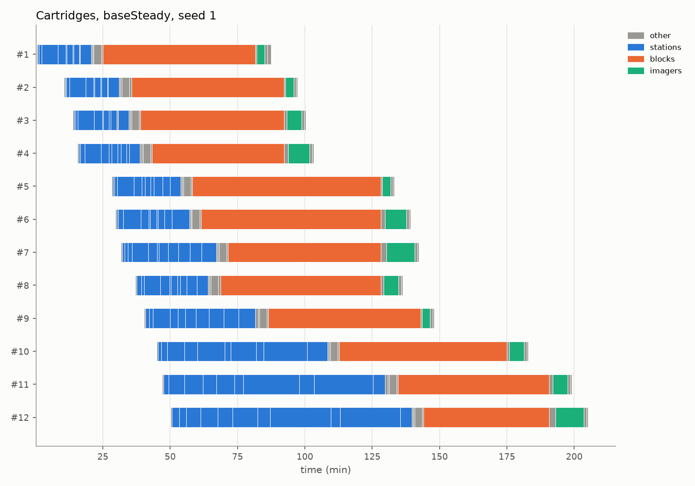
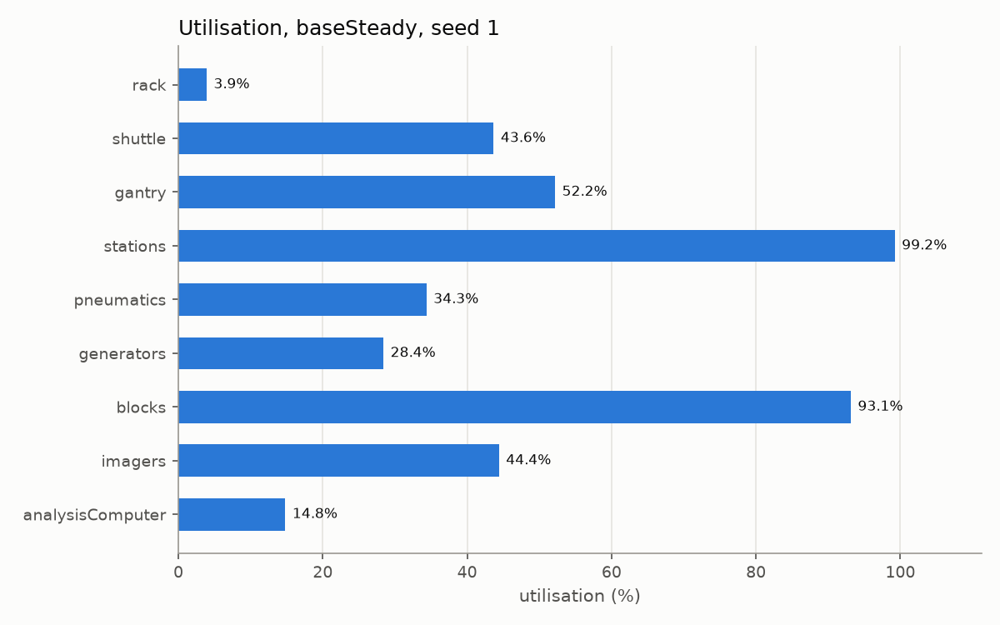
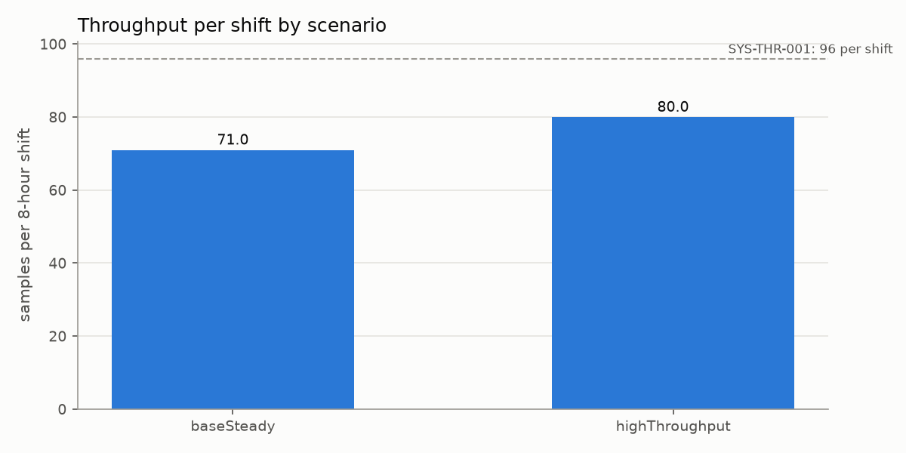
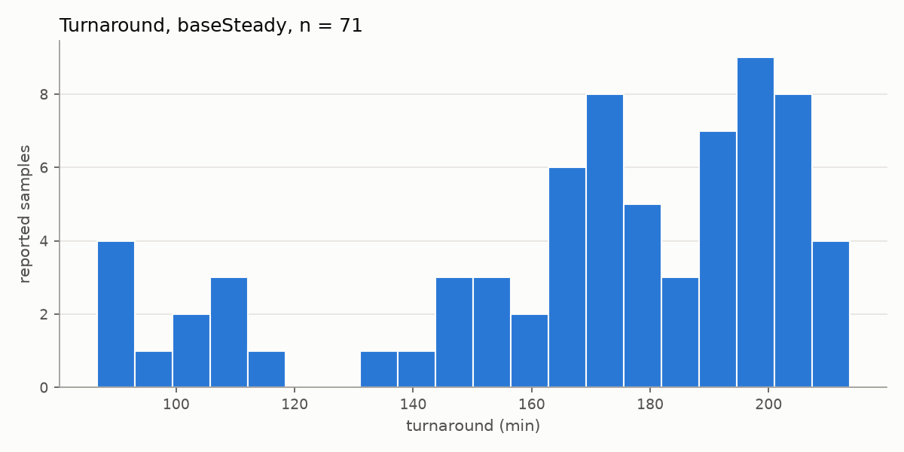
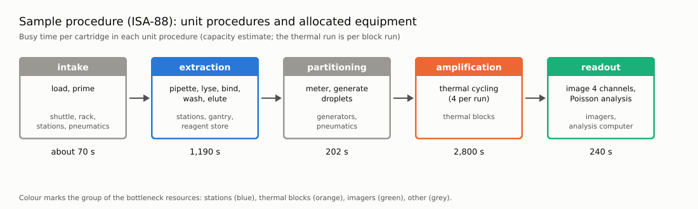

# Halcyon dPCR-24 model

A SysML v2 model of a benchtop droplet digital PCR analyser for 24 swab
samples. The model is checked by the OMG Pilot Implementation and read by
StrictDoc. A generator turns the model into a Salabim discrete-event
simulation. Design verification runs four layers and writes JUnit results
that StrictDoc links to the SYS requirements.

## What this repository contains

- `model/`: the SysML v2 model (SimLib, requirements, design). See `model/README.md`.
- `generator/`: SysML to IR loader, IR, Salabim backend, analytic bounds,
  animation and plots.
- `verification/`: four design verification layers, with JUnit output.
- `tools/`: `run.py` (CLI) and `sysml_conformance.py` (Pilot gate).
- `tests/`: pytest tests of the generator and the tools.
- `docs/design/`: the conventions contract, the capacity estimate and the working notes.

## Prerequisites

- Python 3.15 at `/home/david/.local/bin/python3.15`
- uv
- Java 21 for the SysML v2 Pilot Implementation conformance check
- StrictDoc from branch `david/sysml-format`

## Setup

```sh
uv venv --python /home/david/.local/bin/python3.15 .venv
uv pip install -e /home/david/strictdoc
uv pip install -r pyproject.toml --extra dev
```

## Repository layout

```
model/          SysML v2 model (read by StrictDoc and the generator)
generator/       loader, IR, Salabim backend, analytics, animation, plots
verification/    layers 1-4 and the JUnit writer
tools/           run.py CLI, PilotCheck.java, sysml_conformance.py
tests/           pytest (generator, fixtures)
docs/design/     conventions, capacity estimate, working notes
docs/images/     sample plots (PNG and SVG) used in the docs
build/           generated output (git-ignored)
```

## Running

All commands run from the repository root with `uv run`.

```sh
uv run python tools/run.py check                 # layer 1 + Pilot gate
uv run python tools/run.py bounds                # layer 2 analytic bounds
uv run python tools/run.py simulate --scenario baseSteady --replications 10
uv run python tools/run.py verify                # all layers, JUnit
uv run python tools/run.py plots                 # build/plots/*.png, *.svg
uv run python tools/run.py animate --scenario baseSteady --video build/media/x.mp4 --horizon-h 1
uv run python tools/run.py animate --scenario baseSteady --live   # needs a display
```

Scenarios: `baseBatch` (24 samples at shift start), `baseSteady` (12 per
hour, 10% STAT), `highThroughput` (three thermal blocks, two imagers).

Tests: `uv run --extra dev pytest` (generator and fixture tests).

Outputs: `build/` (plots, animation, StrictDoc HTML) is git-ignored. The
JUnit results go to `reports/junit/`, which is deliberately not ignored by
git: StrictDoc drops any path that `.gitignore` matches, so a results folder
under `build/` would never reach the test-report page. Keep `reports/`
untracked by choice, not by ignore rules.

StrictDoc export (test-report page at
`build/strictdoc/html/halcyon-dpcr-model/reports/junit/`):

```sh
uv run strictdoc export . --output-dir build/strictdoc --config strictdoc_config.py
```

## Example output

Sample plots from `tools/run.py plots` (seed 1, scenario `baseSteady`).
Each is also available as SVG in `docs/images/`. Regenerate the originals
into `build/plots/` and copy them over to refresh these.



Each row is one cartridge. Blue bars are extraction-station steps, orange
the thermal block, green the imager. The long orange bars show the thermal
blocks as the bottleneck.







The sample procedure as a diagram (`docs/images/process-flow.svg`):



## Design verification

`tools/run.py verify` runs the four layers. Each check is a function
`check_*` in `verification/layer*.py`, and its docstring carries a
`@relation(<UID>, scope=function)` marker. The results go to
`build/results/halcyon-verification.pytest.junit.xml`. StrictDoc imports
that file (`.pytest.junit.xml` suffix) and links each test result to its
SYS requirement through the marker.

- Layer 1: model completeness (satisfy/verify coverage, allocations,
  ModelCheck capability values) and the Pilot gate.
- Layer 2: analytic utilisation and throughput bounds. Reproduces
  `docs/design/capacity_estimate.md`. Fails infeasible bounds.
- Layer 3: seeded replications, 95% confidence bound on the requirement's
  constraint, and a +/-20% duration sweep reported as margin.
- Layer 4: conservation, Little's law (drained run), seed reproducibility,
  the hand-calculated single-sample path, and utilisation against layer 2.

A requirement passes only if its constraint holds on the confidence bound.

Sensitivity (layer 3): each simulated check is also run with every step
duration scaled by 0.8 and 1.2, with 5 replications each. The JUnit
properties of the check show where the margin appears:

- `MARGIN`: the relative margin of the nominal run, (bound - threshold) /
  threshold, positive when the requirement holds.
- `SENS_MINUS20_MEAN`, `SENS_PLUS20_MEAN`: the mean metric at each scale.
- `SENS_MINUS20_MARGIN`, `SENS_PLUS20_MARGIN`: the margin at each scale.

StrictDoc shows these as fields of the test result in the test-report page
(`reports/junit/`), next to the PASS/FAIL status and the REQUIREMENT UID.
